# Introducción

SIGPI (Sistema Inteligente para la Gestión y Priorización de Incidencias) recibe las
solicitudes de soporte técnico de la comunidad universitaria, las clasifica
automáticamente, calcula su prioridad y las asigna al técnico más adecuado. Este manual
explica cómo usar el sistema en el día a día y está dividido en dos guías:

- **Guía del técnico** (rol *Agente de soporte*): consultar y atender las solicitudes,
  usar *Mi bandeja*, poner una solicitud en espera, revisar clasificaciones y leer los
  avisos.
- **Guía del administrador** (rol *Administrador*): asignar técnicos, consultar los
  indicadores y exportarlos a CSV, administrar el clasificador y mantener el catálogo de
  categorías.

Las capturas de pantalla corresponden a la versión actual de la rama principal del
repositorio y se tomaron con datos de ejemplo; los nombres, folios y cifras son
ficticios.

## Roles y menús

El menú lateral solo muestra las opciones que corresponden a tus roles. Si una opción
descrita aquí no aparece, tu cuenta no tiene ese permiso: pídeselo al administrador.

| Opción del menú     | Técnico | Administrador | Para qué sirve                                         |
|---------------------|:-------:|:-------------:|--------------------------------------------------------|
| Resumen             | ✔       | ✔             | Pantalla de inicio con el estado general               |
| Solicitudes         | ✔       | ✔             | Lista de todas las solicitudes, con búsqueda y filtros |
| Registro Asistido   | ✔       | ✔             | Registrar una solicitud recibida por teléfono o en persona |
| Mi bandeja          | ✔       | ✔             | Solicitudes asignadas, de la más urgente a la menos urgente |
| Revisión            | ✔       | ✔             | Revisar clasificaciones con baja confianza             |
| Catálogo            | ✔ (consulta) | ✔        | Áreas, categorías, especialidades, turnos y técnicos   |
| Tickets             | ✔       | ✔             | Acuerdos de nivel de servicio (SLA)                    |
| Usuarios            |         | ✔             | Alta y edición de cuentas                              |
| Clasificador        |         | ✔             | Estado, umbral y reentrenamiento del modelo            |
| Indicadores         |         | ✔             | Reportes del periodo y exportación CSV                 |

El rol *Jefe de servicio* ve, además de lo del técnico, la opción **Indicadores** y el
interruptor *Ver todo el equipo* en *Mi bandeja*.

## Iniciar y cerrar sesión

1. Abre SIGPI en el navegador. Si no has iniciado sesión, verás la pantalla
   **Iniciar sesión**.
2. Escribe tu correo institucional y tu contraseña, y pulsa **Iniciar sesión**.
3. Para salir, pulsa el icono de salida que está junto a tu nombre, en la esquina
   inferior del menú lateral.

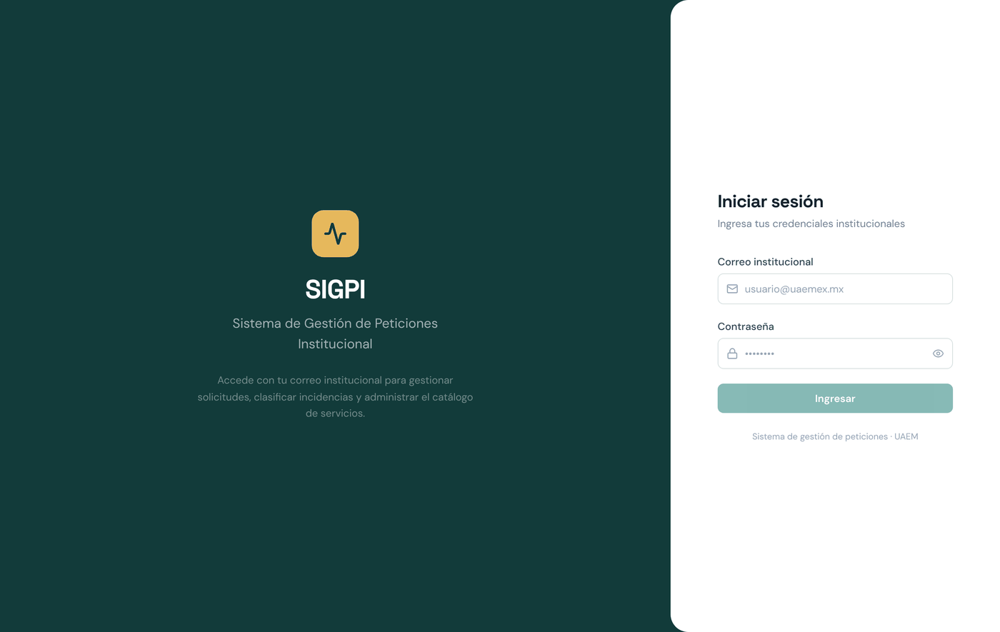

Si tu sesión caduca mientras trabajas, el sistema te lo indicará con el mensaje
*«Tu sesión ha expirado. Inicia sesión nuevamente.»*

## Estados de una solicitud

| Estado                | Significado                                                       |
|-----------------------|-------------------------------------------------------------------|
| Registrada            | Se recibió y espera clasificación                                  |
| Por verificar         | No se localizó al solicitante; hay que verificar sus datos        |
| Clasificada           | Tiene categoría y prioridad, pero aún no tiene técnico            |
| En revisión           | La clasificación tuvo baja confianza y espera a una persona revisora |
| Asignada              | Tiene técnico asignado                                            |
| En proceso            | El técnico ya está atendiéndola                                   |
| En espera             | Detenida por un motivo externo; el reloj del SLA se pausa         |
| Escalada              | Se turnó a un nivel de soporte superior                           |
| Resuelta              | El técnico la resolvió; espera la confirmación del solicitante    |
| Cerrada               | El solicitante confirmó la solución                               |
| Cerrada sin verificar | Se cerró sin que el solicitante confirmara                        |

La **prioridad** va de **P1** (crítica) a **P4** (baja). El sistema la calcula a partir
de la urgencia y el impacto de la solicitud.

# Guía del técnico

## Pantalla de inicio (Resumen)

Al entrar llegas a **Resumen**. Desde ahí puedes ir a cualquier sección con el menú
lateral. En el encabezado, a la derecha, están la **campana de avisos** y tus iniciales.

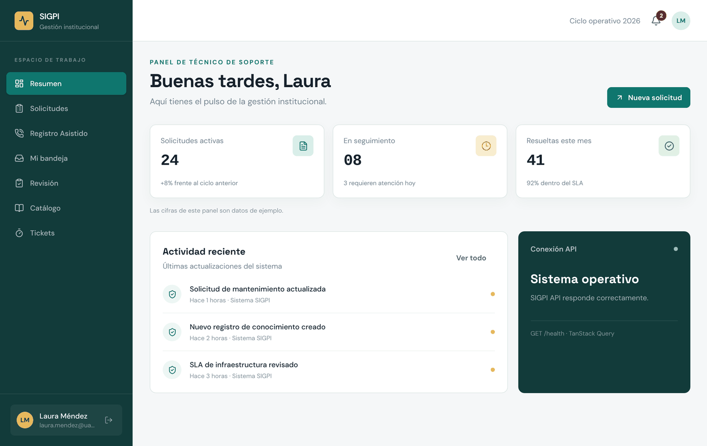

## Mi bandeja

*Mi bandeja* es tu lista de trabajo: muestra solo las solicitudes abiertas que tienes
asignadas (estados *Asignada*, *En proceso*, *En espera* y *Escalada*).

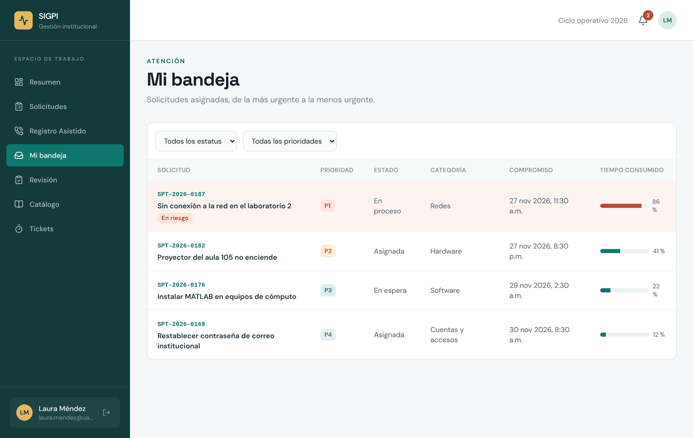

**Cómo leerla**

- **Orden.** Las solicitudes aparecen de la más urgente a la menos urgente: primero por
  prioridad (P1 antes que P4) y, a igual prioridad, por la fecha compromiso más cercana.
- **Compromiso.** Es la fecha y hora límite que fija el acuerdo de servicio (SLA).
- **Tiempo consumido.** La barra indica qué porcentaje del tiempo comprometido ya se
  usó. Si la solicitud no tiene SLA, se muestra *Sin SLA*.
- **En riesgo.** Cuando una solicitud consume el 80 % de su tiempo o más, la fila se
  pinta de rojo claro, la barra cambia a rojo y aparece la etiqueta **En riesgo**.
  Atiende esas solicitudes primero.

**Filtrar.** Usa las listas *Todos los estatus* y *Todas las prioridades* para acotar la
lista. Los filtros se aplican de inmediato.

**Abrir una solicitud.** Pulsa su folio (por ejemplo `SPT-2026-0187`) para ver el
detalle.

Si no tienes nada asignado, verás el mensaje *«No tienes solicitudes asignadas»*.

## Lista de solicitudes

La opción **Solicitudes** muestra todas las solicitudes del sistema, no solo las tuyas.

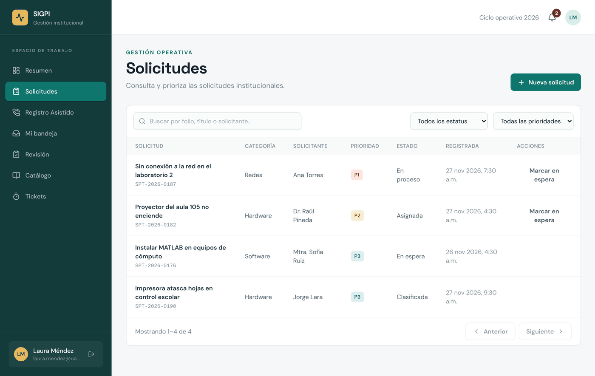

- **Buscar.** Escribe en *Buscar por folio, título o solicitante…*; la búsqueda se lanza
  sola cuando dejas de escribir.
- **Filtrar.** Por estatus y por prioridad.
- **Paginar.** Se muestran 10 solicitudes por página; usa **Anterior** y **Siguiente**.
- **Abrir el detalle.** Pulsa el título de la solicitud.
- **Nueva solicitud.** El botón **Nueva solicitud** abre el formulario de registro.

## Detalle de una solicitud

El detalle reúne toda la información de una solicitud:

- **Encabezado:** folio, título, prioridad y estado actual.
- **Datos de la solicitud:** descripción, solicitante, canal, ubicación, urgencia,
  impacto y fechas clave (registro, primera respuesta, resolución, cierre) junto con el
  *tiempo efectivo de resolución*, que no cuenta el tiempo en espera.
- **Clasificación automática:** la categoría que propuso el modelo, su confianza y la
  versión del modelo.
- **Técnico asignado** y **Asignar técnico:** quién atiende la solicitud y por qué se le
  eligió (ver la [guía del administrador](#asignar-un-técnico)).
- **Diagnóstico y solución:** lo que se registró al atender la solicitud.
- **Bitácora:** el historial completo de acciones, con fecha, autor y cambio de estado.
  Tus propias acciones aparecen como *Tú*.

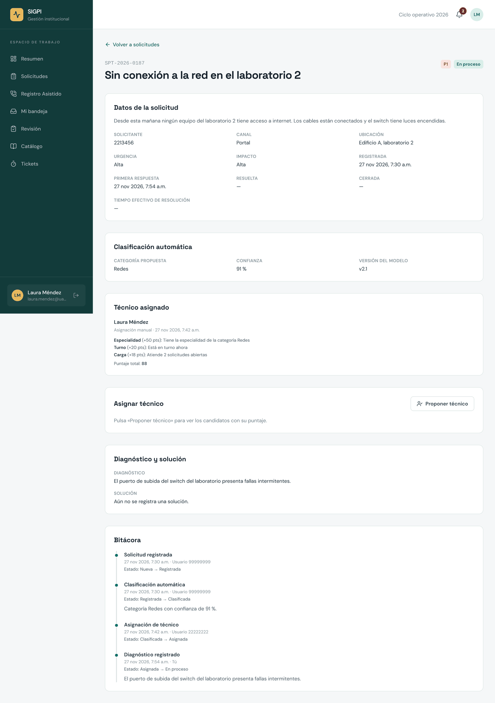

Si la solicitud está **Por verificar**, un aviso amarillo indica que el solicitante aún
no se ha localizado; consulta la bitácora para ver el motivo.

## Poner una solicitud en espera

Cuando no puedes avanzar por una causa ajena (falta un repuesto, esperas información del
solicitante), pon la solicitud en espera. Mientras está en espera, **el reloj del SLA se
detiene**.

1. Ve a **Solicitudes** y localiza la solicitud. Solo las solicitudes *Asignada* o
   *En proceso* muestran el botón **Marcar en espera** en la columna *Acciones*.
2. Pulsa **Marcar en espera**. Se abre el cuadro *Motivo de espera*.
3. Elige el motivo:
   - *Esperando insumo externo*
   - *Esperando información del solicitante*
   - *Otro (especificar)*: en este caso es obligatorio describir el motivo.
4. Pulsa **Guardar espera**. La solicitud cambia a *En espera* y la acción queda en la
   bitácora.

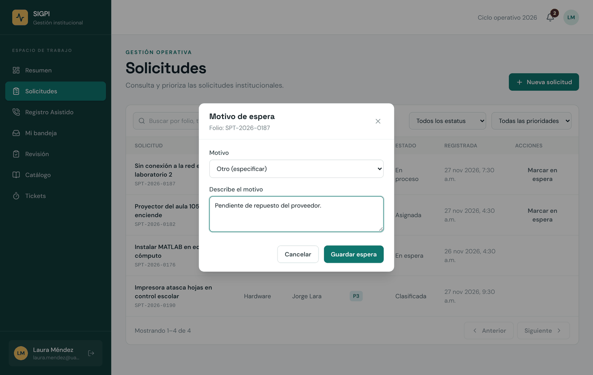

> **Nota sobre la versión actual.** El servidor ya registra el diagnóstico, el inicio de
> la atención, la resolución y la reanudación de una espera, y esos datos se ven en el
> detalle y en la bitácora. Sin embargo, en esta versión la interfaz todavía no tiene
> botones para esas acciones; por ahora solo **Marcar en espera** se hace desde la
> pantalla.

## Registro asistido

Usa **Registro Asistido** cuando alguien reporta una falla por teléfono o en persona.

1. En **Buscar solicitante**, escribe su nombre, matrícula o correo y selecciónalo.
2. Elige el canal (*Teléfono* o *Presencial*).
3. Escribe el **Título**, la **Descripción** y la **Ubicación física** del problema.
4. Indica la **Categoría**, la **Urgencia** y el **Impacto**.
5. Pulsa **Registrar solicitud** (o **Limpiar** para empezar de nuevo). Al terminar
   puedes pulsar **Registrar otra solicitud** para capturar la siguiente.

## Revisión de clasificaciones

Cuando el modelo clasifica una solicitud con una confianza menor al umbral, la solicitud
pasa a **Revisión** y necesita que una persona la confirme o la corrija antes de
continuar.

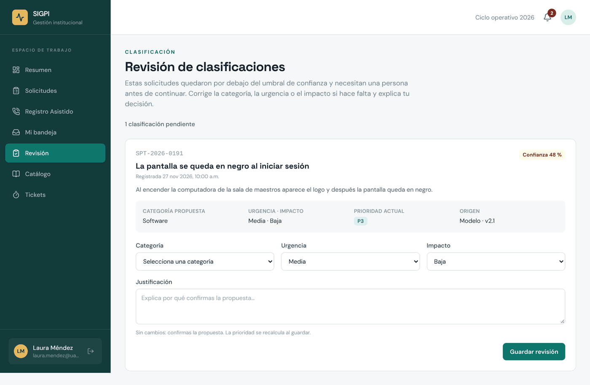

1. Abre **Revisión**. Cada tarjeta muestra la solicitud, la confianza del modelo, la
   categoría propuesta, la urgencia, el impacto y la prioridad actual.
2. Si la propuesta es correcta, déjala como está. Si no, corrige la **Categoría**, la
   **Urgencia** o el **Impacto**.
3. Escribe la **Justificación** (es obligatoria, tanto si corriges como si confirmas).
4. Pulsa **Guardar revisión**. La prioridad se recalcula al guardar.

Tus correcciones se guardan y sirven para reentrenar el clasificador más adelante.

## Avisos

La campana del encabezado te informa de lo que pasa con tus solicitudes. El número rojo
indica cuántos avisos tienes sin leer (a partir de 100 se muestra *99+*).

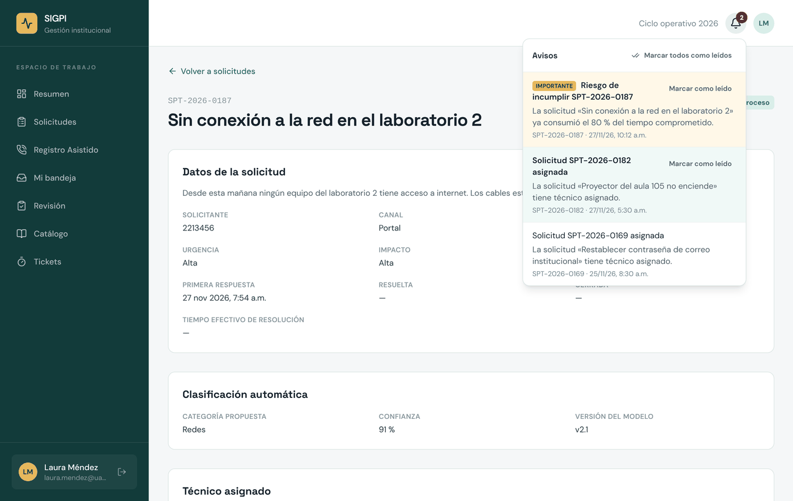

**Qué avisos recibe un técnico**

| Aviso                                   | Cuándo llega                                       | Importancia |
|-----------------------------------------|----------------------------------------------------|-------------|
| *Solicitud … asignada*                  | Cuando te asignan una solicitud                     | Normal      |
| *Riesgo de incumplir …*                 | Cuando una solicitud tuya consume el 80 % de su tiempo | **Importante** |
| *Solicitud … cerrada*                   | Cuando se cierra una solicitud que atendiste        | Normal      |

**Cómo usarlos**

- Pulsa la campana para abrir la lista. Los avisos sin leer se ven resaltados y los
  importantes llevan la etiqueta **IMPORTANTE** sobre fondo amarillo.
- Pulsa el asunto de un aviso para ir directamente al detalle de la solicitud; el aviso
  se marca como leído.
- **Marcar como leído** marca un aviso sin abrirlo; **Marcar todos como leídos** limpia
  la lista completa.
- Para cerrar la lista, pulsa fuera de ella o presiona *Esc*.

Los avisos se muestran dentro de SIGPI; el sistema no envía correo electrónico.

# Guía del administrador

El administrador tiene todas las opciones del técnico más las que se describen aquí.

## Asignar un técnico

SIGPI propone al técnico más adecuado para cada solicitud con un **puntaje** que combina
tres criterios:

- **Especialidad:** si el técnico tiene una especialidad de la categoría de la solicitud.
- **Turno:** si está en turno en ese momento.
- **Carga:** cuántas solicitudes abiertas atiende ya; menos carga, más puntos.

**Pasos**

1. Abre el detalle de la solicitud (desde **Solicitudes** o **Mi bandeja**). El panel
   **Asignar técnico** solo aparece si la solicitud sigue abierta; una solicitud
   *Resuelta* o *Cerrada* ya no se asigna.
2. Pulsa **Proponer técnico**. Aparece la lista de candidatos ordenada por puntaje; el
   primero lleva la etiqueta **Sugerido**.
3. Revisa el desglose de cada candidato: los puntos que aportó cada criterio y su carga
   actual.
4. Pulsa **Asignar** en el candidato elegido y luego **Confirmar** (o **Cancelar** si
   cambias de opinión).
5. Verás el mensaje *«Solicitud asignada a …»*. El técnico recibe un aviso.

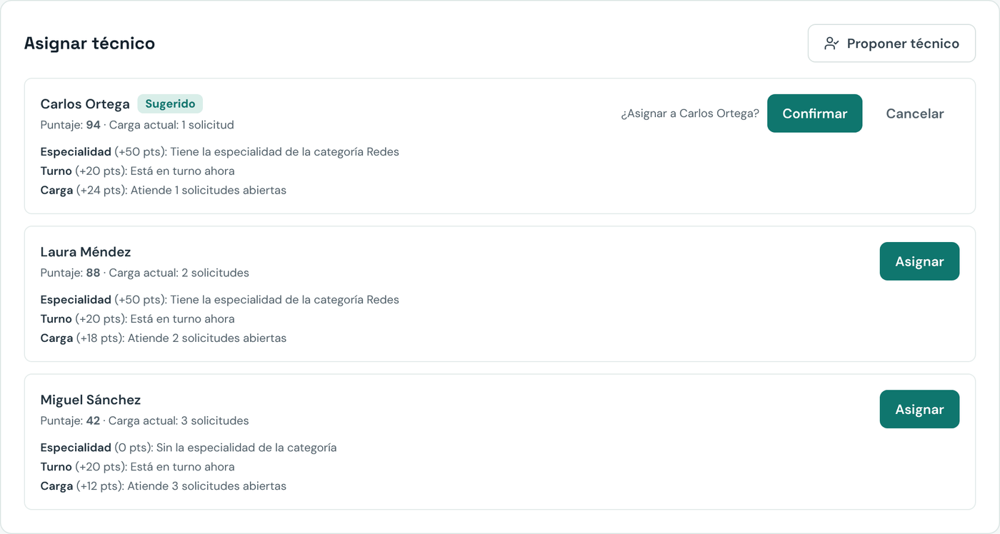

Si no hay técnicos que puedan atender la categoría, se muestra *«No hay técnicos
disponibles para esta categoría»*. En ese caso revisa en **Catálogo** que algún técnico
tenga la especialidad y el turno correctos.

**Consultar por qué se asignó a alguien.** El panel **Técnico asignado** muestra quién
atiende la solicitud, si la asignación fue automática o manual, la fecha y el desglose de
su puntaje.

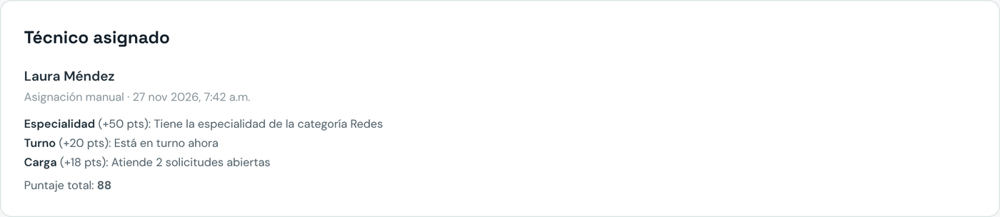

**Ver la bandeja de todo el equipo.** En **Mi bandeja**, activa el interruptor **Ver todo
el equipo** para ver las solicitudes asignadas a cualquier técnico, no solo a ti.

## Indicadores y exportación CSV

**Indicadores** resume el desempeño del servicio en un periodo.

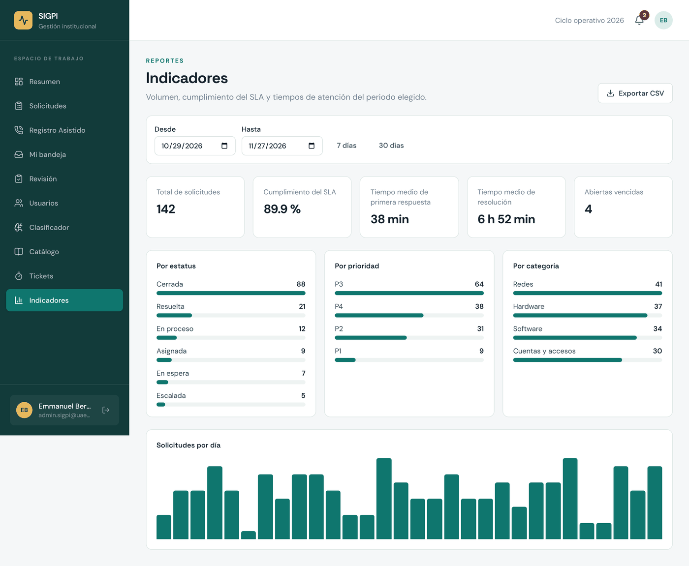

**Elegir el periodo**

- Por omisión se muestran los **últimos 30 días**, hoy incluido.
- Cambia las fechas **Desde** y **Hasta**, o usa los atajos **7 días** y **30 días**.
- Si *Desde* es posterior a *Hasta* o falta alguna fecha, el sistema lo indica y no
  calcula nada hasta que el rango sea válido.

**Qué muestra**

| Indicador                           | Significado                                                        |
|-------------------------------------|--------------------------------------------------------------------|
| Total de solicitudes                | Solicitudes registradas en el periodo                              |
| Cumplimiento del SLA                | Porcentaje de solicitudes resueltas con SLA que se resolvieron a tiempo |
| Tiempo medio de primera respuesta   | Promedio desde el registro hasta la primera respuesta              |
| Tiempo medio de resolución          | Promedio del tiempo efectivo de resolución (sin esperas)           |
| Abiertas vencidas                   | Solicitudes abiertas que ya pasaron su fecha compromiso            |

Debajo aparecen gráficas **por estatus**, **por prioridad** y **por categoría**, y la
serie de **solicitudes por día**. Si el periodo no tiene solicitudes, se muestra
*«No hay solicitudes registradas en este rango»*.

**Exportar a CSV**

1. Elige el periodo.
2. Pulsa **Exportar CSV**. El archivo se descarga con el nombre
   `indicadores_AAAA-MM-DD_AAAA-MM-DD.csv` y aparece el mensaje *«Se descargó …»*.
3. Ábrelo en Excel u otra hoja de cálculo; los acentos se leen correctamente.

El CSV tiene una fila por solicitud del periodo con estas columnas: *Folio*, *Título*,
*Categoría*, *Prioridad*, *Estatus*, *Fecha de alta*, *Primera respuesta*, *Resuelta*,
*Cerrada*, *Minutos de resolución* y *Cumplió SLA*.

## Administración del clasificador

La opción **Clasificador** permite vigilar y ajustar el modelo que clasifica las
solicitudes.

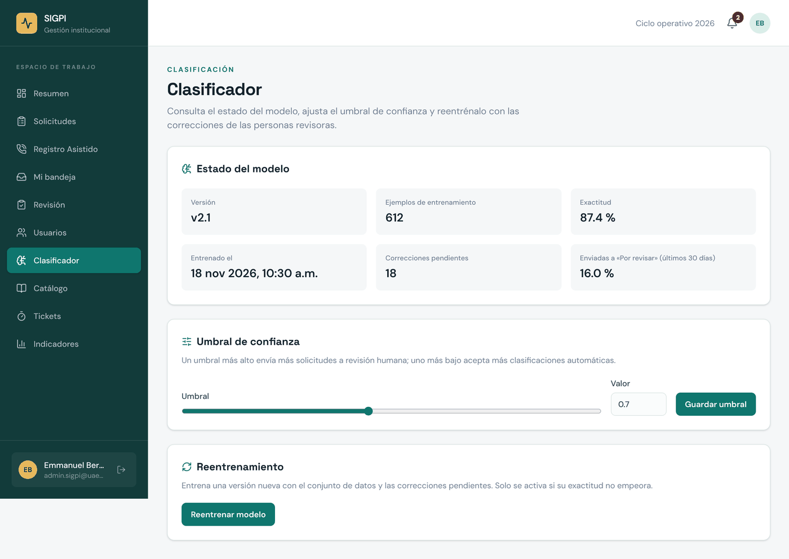

**Estado del modelo.** Muestra la versión activa, el número de ejemplos con que se
entrenó, su exactitud, la fecha de entrenamiento, las **correcciones pendientes** (las
revisiones humanas que aún no se usan para entrenar) y qué proporción de solicitudes se
envió a revisión en los últimos días.

**Ajustar el umbral de confianza.**

- El umbral decide cuándo una clasificación necesita revisión humana: si la confianza
  del modelo queda por debajo, la solicitud va a **Revisión**.
- Un umbral **más alto** envía más solicitudes a revisión; uno **más bajo** acepta más
  clasificaciones automáticas.
- Muévelo con el deslizador o escribe el valor (entre **0.50** y **0.95**, en pasos de
  0.05) y pulsa **Guardar umbral**. Verás *«Umbral actualizado de … a …»*.

**Reentrenar el modelo.**

1. Pulsa **Reentrenar modelo** y confirma con **Sí, reentrenar**. Puede tardar unos
   segundos.
2. El sistema entrena una versión nueva con el conjunto de datos y las correcciones
   pendientes.
3. La versión nueva **solo se activa si su exactitud no empeora**. El resultado indica
   si se activó, la exactitud nueva frente a la anterior, los ejemplos usados y las
   correcciones incorporadas.

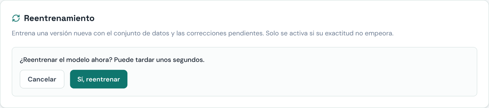

Conviene reentrenar cuando se han acumulado correcciones pendientes o cuando la
proporción de solicitudes enviadas a revisión crece.

## Catálogo: áreas, categorías, especialidades y turnos

El **Catálogo** define cómo se organiza el servicio. Las categorías son la base de la
clasificación y de la asignación: el modelo asigna una categoría a cada solicitud y el
puntaje busca técnicos con una especialidad de esa categoría.

La jerarquía es: **Área de servicio → Categoría → Especialidad**. Los **turnos** se
definen aparte y se asignan a cada técnico.

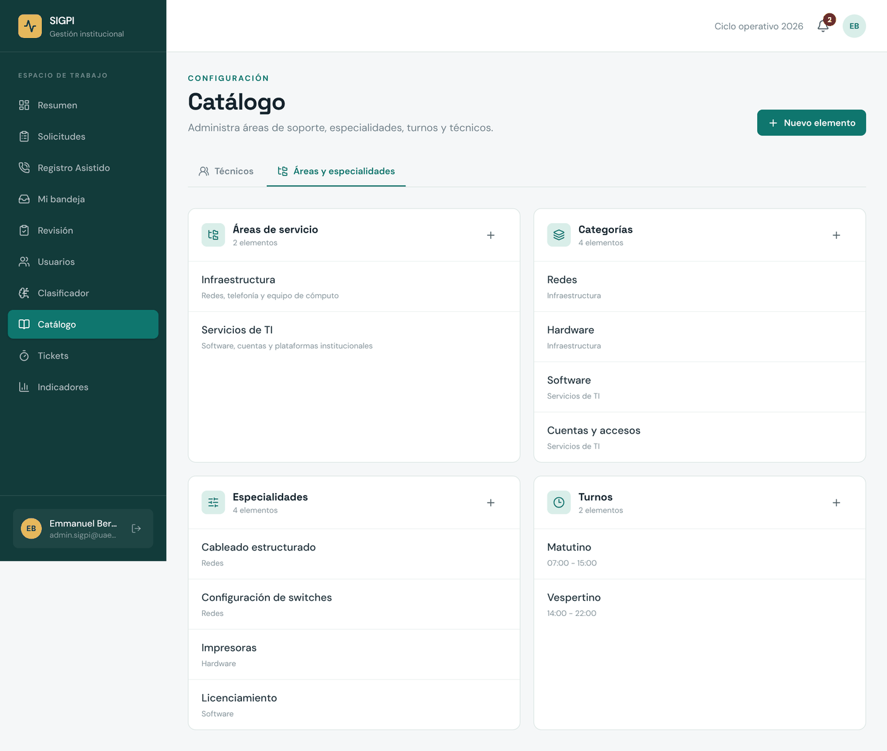

**Agregar un elemento**

1. Abre **Catálogo** y la pestaña **Áreas y especialidades**.
2. Pulsa el botón **+** del grupo que quieras ampliar (*Áreas de servicio*,
   *Categorías*, *Especialidades* o *Turnos*). El botón **Nuevo elemento** abre
   directamente el alta de un área.
3. Completa el formulario:
   - **Área:** elige la unidad organizacional, el nombre y, si quieres, una descripción.
   - **Categoría:** elige el área de servicio a la que pertenece, el nombre y una
     descripción opcional (hasta 300 caracteres).
   - **Especialidad:** elige primero la categoría y luego el nombre.
   - **Turno:** elige el turno; su horario es fijo y se muestra solo como referencia.
4. Pulsa **Guardar**.

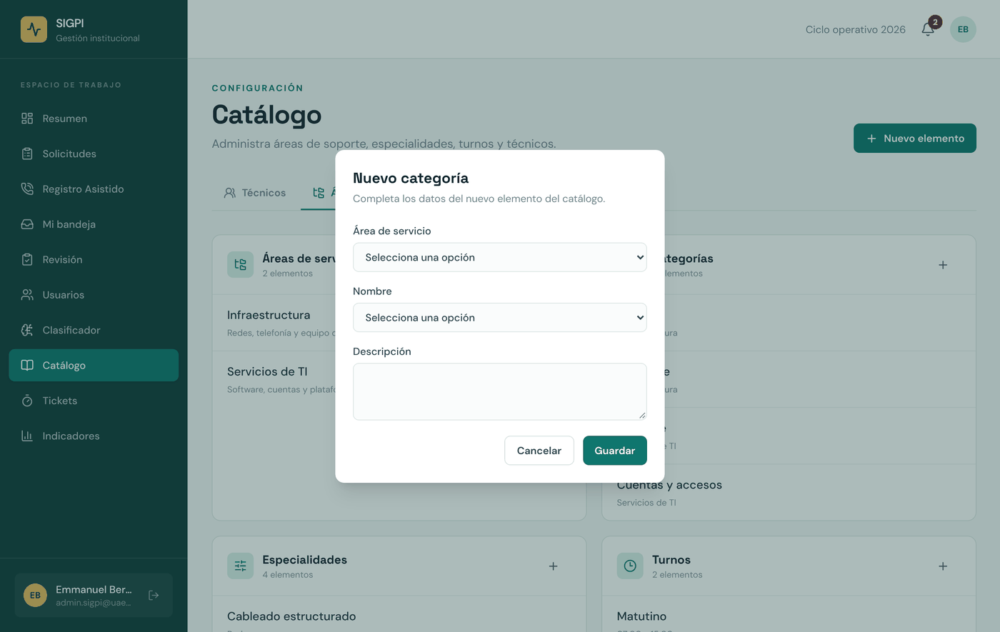

Los nombres se eligen de una lista predefinida. Los que ya existen aparecen
deshabilitados con la marca *(ya registrada)*, así no se duplican. En esta versión el
catálogo permite agregar elementos, pero no editarlos ni eliminarlos desde la pantalla.

## Catálogo: configurar técnicos

La pestaña **Técnicos** lista a los usuarios con perfil técnico, con su nivel, turno y
especialidades, y muestra cuántos técnicos activos, especialidades y turnos hay.

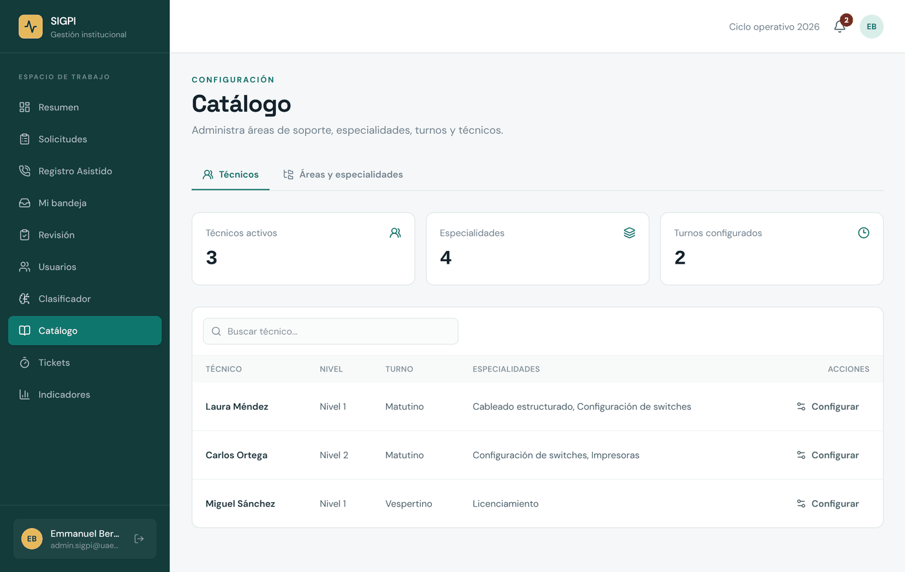

Para cambiar el perfil operativo de un técnico:

1. Busca al técnico y pulsa **Configurar**.
2. Ajusta el **Nivel de soporte** (Nivel 1 o Nivel 2), el **Turno**, la **Carga máxima**
   y las **Especialidades habilitadas**.
3. Pulsa **Guardar cambios**.

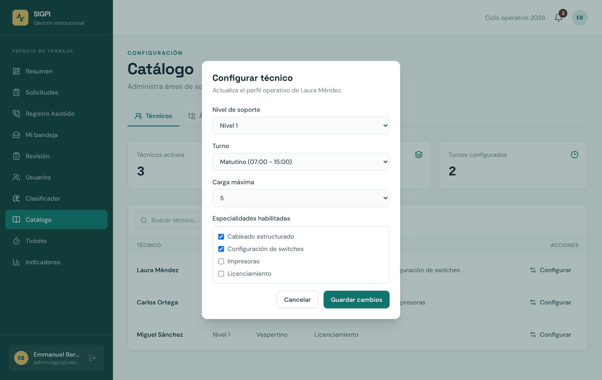

Estos datos alimentan directamente el puntaje de asignación: un técnico sin
especialidades ni turno difícilmente aparecerá como sugerido.

# Preguntas frecuentes

**No veo una opción del menú.**
El menú depende de tus roles. Pide al administrador que revise tu cuenta en **Usuarios**.

**Una solicitud no aparece en *Mi bandeja*.**
La bandeja solo muestra solicitudes abiertas que tienes asignadas. Las *Resueltas*,
*Cerradas* o sin técnico no aparecen; búscalas en **Solicitudes**.

**¿Por qué no aparece el botón *Marcar en espera*?**
Solo se ofrece para solicitudes *Asignada* o *En proceso*.

**«Proponer técnico» no devuelve candidatos.**
Ningún técnico activo cumple los criterios para la categoría. Revisa en **Catálogo →
Técnicos** que alguno tenga la especialidad y el turno adecuados.

**El reentrenamiento terminó pero dice «no activada».**
La versión nueva salió con menor exactitud que la vigente, así que el sistema conservó la
anterior. Puedes seguir acumulando correcciones y volver a intentarlo.

**¿Quién recibe el aviso de una P1 sin asignar?**
Los usuarios con rol *Jefe de servicio*, cuando una solicitud P1 lleva cinco minutos sin
técnico. El mismo rol recibe también los avisos de riesgo de SLA.
